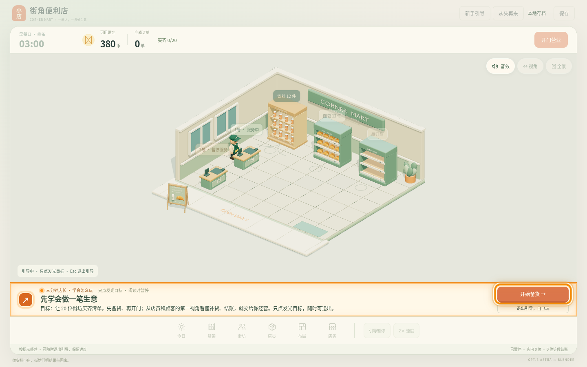
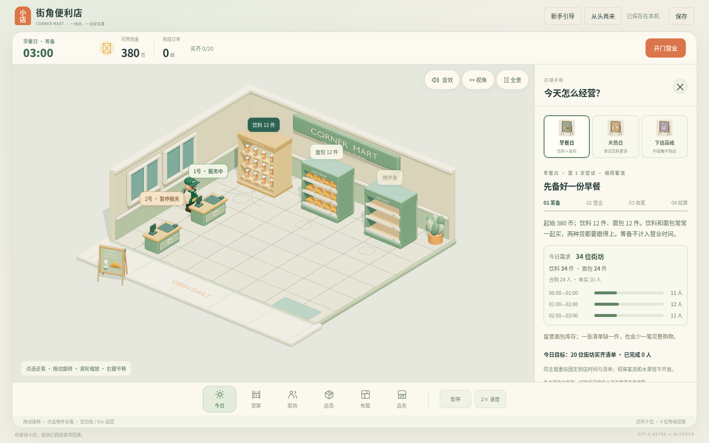
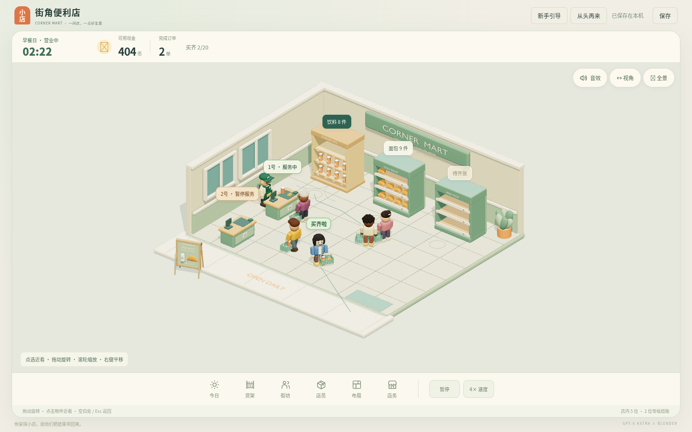
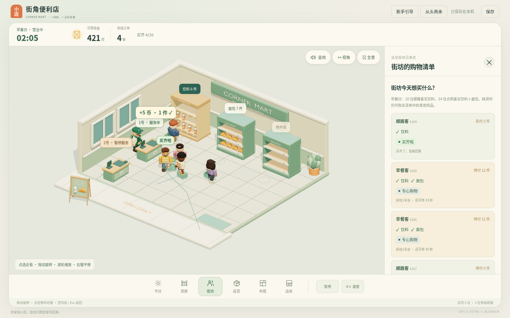
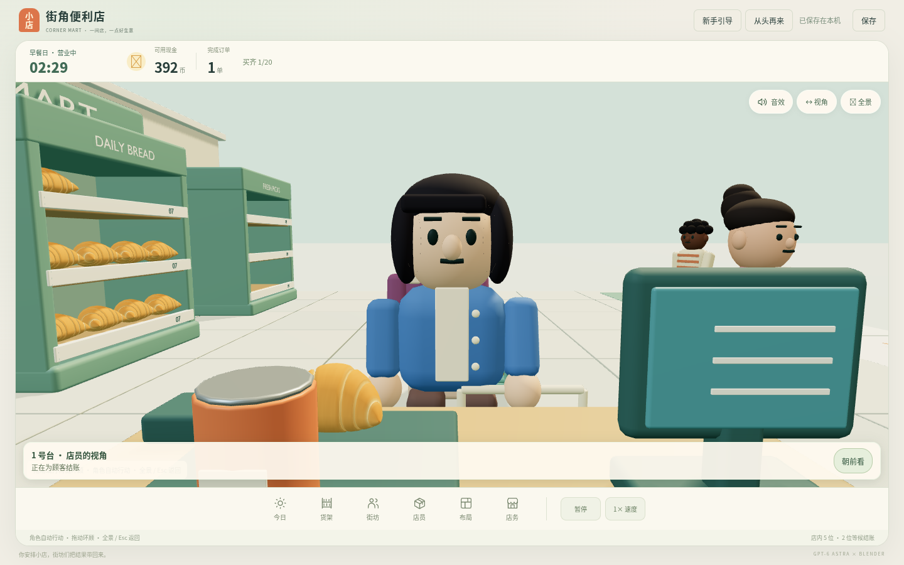
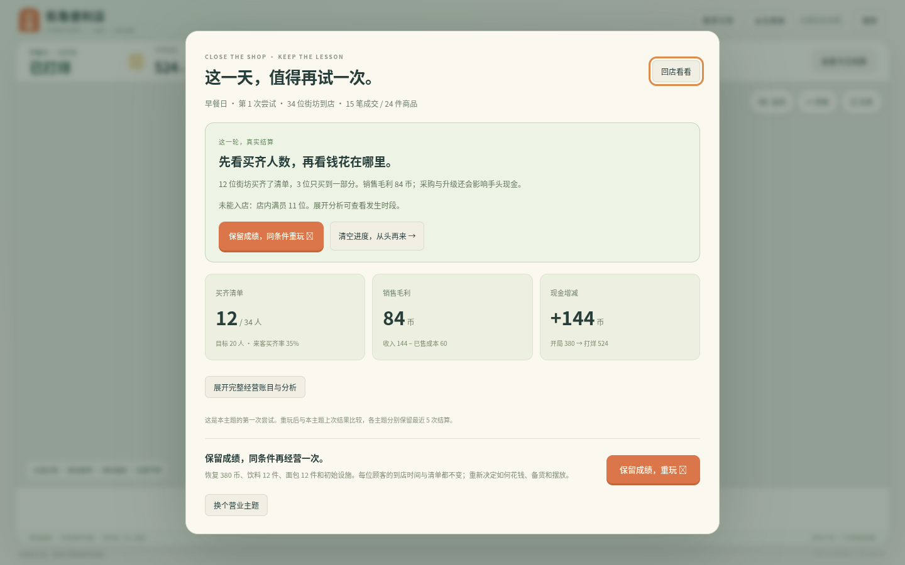

# 街角便利店 · Corner Mart

一间可以在浏览器里经营三分钟的 3D 便利店。游戏代码和 Blender 生成脚本由 **GPT-6 Astra** 编写，全部可编辑的 3D 资产由 **Blender** 生成，最后用 TypeScript + Three.js 组装成可玩的游戏。

> A small browser management game. GPT-6 Astra writes the game code and the Blender generator scripts, Blender produces every editable 3D asset, and TypeScript + Three.js run the game. It uses no paid asset services, downloaded models or texture packs.



## 玩法

开门前先看今天的客流和商品需求，再决定备货、升级和货架布局。营业 3 分钟后结算，还可以在完全相同的客流下重玩一次，比较两种策略的差别。

| 筹备：看需求、选主题 | 营业：顾客按清单拿货、排队结账 |
|---|---|
|  |  |
| **街坊：每位顾客的清单与心情** | **第一视角：站到收银台后面** |
|  |  |

- 三个营业主题：早餐日、炎热日和下班高峰。每个主题的需求曲线和店内光照都不同。
- 顾客带着购物清单逐件拿货，最后一次付清。缺货或排队太久，顾客会失望离开。
- 两个收银台。兼岗店员处理完手上的收银单就去补货；补货可以设为缺货优先、饮料优先或面包优先。
- 饮料架有三档：木架、带灯架、冷藏柜。布局有两套：通道优先和补货优先。
- 可以切到店员或任意一位顾客的第一视角。
- 结算时毛利和现金分开算，并逐条列出钱花在哪、顾客为什么离开。



## 快速开始

需要 Node.js 20.19+（或 22.12+），以及支持 WebGL 的浏览器。

```sh
npm ci
npm run dev        # http://127.0.0.1:9418/
npm test           # 逻辑测试
npm run build      # 输出静态站点到 dist/
npm run preview    # 本地预览构建结果
```

`dist/` 是纯静态文件，可以放到任意静态托管上。进度保存在浏览器的 localStorage 里，三个主题各存一份。右上角的「从头再来」会清空进度，清空前会确认。

## 用 GPT-6 Astra + Blender 做游戏

这个仓库真正想展示的是**开发方式**，游戏是这套方式的产物。

1. **人提需求，模型写生成脚本。** GPT-6 Astra 不直接"画"模型，而是编写 `assets/source/*.py`。这些脚本在后台运行的 Blender 里，用代码搭出店铺、货架、人物、货箱和告示牌。
2. **每个资产保留两份。** 一份是 `.blend` 源文件，可以在 Blender 里继续手工修改；另一份是去掉重复几何、给游戏运行用的 `.glb`。
3. **用规格文件对齐资产和代码。** `assets/specs/*.json` 记录挂点名（例如 `shelf.drinks`、`stop.drinks`）、尺寸和商品槽位。游戏加载模型时会核对这些接口，所以改了模型外观不会弄坏经营逻辑。
4. **用测试守住每一轮迭代。** 经营规则和渲染完全分开，模拟用固定时间步和固定随机种子，同样的输入每次都得到同样的结果。每次改动都要先通过逻辑测试。

想自己改一处模型，可以从这里开始（详见 [docs/blender-assets.md](docs/blender-assets.md)）：

> 打开 `drink-shelf-lit.blend`，只调整灯带颜色，保留 `shelf.drinks`、`stop.drinks` 和各个商品单元的接口；导出新的 GLB，确认外观变了，而经营进度不受影响。

## 目录结构

```text
src/              游戏代码（TypeScript）
  sim.ts            经营规则：库存、预留、订单、结账；不依赖 Three.js
  day.ts            营业日流程：筹备 → 营业 → 收尾 → 结算，以及同条件重玩
  navigation.ts     路径规划与人物避让
  view.ts           Three.js 场景：摆放 GLB、动画插值、点选与标注
  guided-tour.ts    新手引导
  first-person.ts   第一视角跟随
  main.ts           入口：连接界面、存档和游戏循环
tests/            逻辑测试（node:test + tsx）
public/assets/    运行时资源：GLB 模型和 WebP 预览图
assets/source/    Blender 源文件（.blend）和生成脚本（.py）
assets/specs/     资产接口规格，以及测试用的起始状态
scripts/          在后台调用 Blender 运行生成脚本的包装器，以及 GLB 修补脚本
docs/             架构说明、资产说明、README 截图
```

架构细节见 [docs/architecture.md](docs/architecture.md)。

## 技术栈

TypeScript 5.9 · Three.js 0.180 · Vite 7 · Blender 5.2 LTS（Python API）· Web Audio（音效由程序实时合成，不含音频文件）

## 已知局限

- 人物用刚性关节动画，没有 IK，也没有手指抓取。寻路只在平面上进行，人与人之间的避让用圆形近似。
- 数值是第一轮的候选值，还没有经过真实玩家测试。"能完成目标"、"账目对得上"和"玩起来有趣"是三件要分开验证的事。
- 资产脚本是一轮轮迭代写出来的，后一轮会打开前一轮保存的 `.blend` 接着改。所以单独运行某一个脚本，不等于从零重建全部资产。

## 许可

本项目以 [MIT](LICENSE) 许可发布。第三方组件的许可见 [THIRD_PARTY_LICENSES.txt](THIRD_PARTY_LICENSES.txt)（three.js，MIT）。
